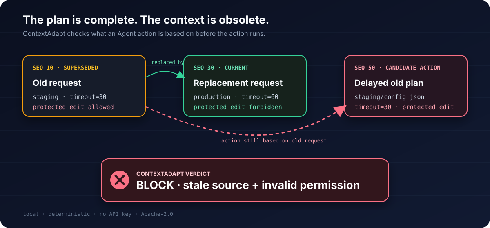

# ContextAdapt

[](https://github.com/cooleryu/ContextAdapt/actions/workflows/ci.yml)
[](LICENSE)
[](package.json)

**Help every Agent use the smallest context that can still act safely.**

Too little context can drop the current target, a corrected value, or a revoked permission. Too much context adds cost and latency without guaranteeing that the Agent will act from the right evidence. ContextAdapt's north star is to recommend the smallest safe context tier, then verify the resulting action before the real tool call.

Version 0.2 contains the core P0 runtime loop: two independent Luna captures turn a natural-language task update into reviewed state; the host records permissions, successful tool state, and token positions; ContextAdapt selects 200K, 400K, or the 1M-window tier before the task Agent; Codex/OMP check the actual write arguments immediately before mutation; and a recoverable stale scalar can trigger exactly one target-bound read-only refresh before a second gate. The Codex reference path can now observe an opt-in ordinary task without touching its primary run, stay out with zero Luna calls when 200K already fits, and replay a supported task from its real pre-write state. The engineering slice is accepted; the multi-bucket natural cohort is still accumulating. See the [product roadmap](docs/product-roadmap.md).

## Choosing a context window

How much context does a coding agent need? Start with the practical guide to compare context budgets, total cost, latency, and task verification: [English guide](https://cooleryu.github.io/ContextAdapt/guides/choosing-context-length-for-coding-agents/) · [中文指南](https://cooleryu.github.io/ContextAdapt/guides/choosing-context-length-for-coding-agents/zh-CN/).

## Articles / 文章

- **Codex at 500K: more room, but check the state before writing** — [English](https://cooleryu.github.io/ContextAdapt/articles/codex-500k-context/) · [中文](https://cooleryu.github.io/ContextAdapt/articles/codex-500k-context/zh-CN/)
- **The Plan Was Valid. The World Had Changed. / 计划没有错，世界已经变了** — [English](https://cooleryu.github.io/ContextAdapt/articles/the-plan-was-valid/en/) · [中文](https://cooleryu.github.io/ContextAdapt/articles/the-plan-was-valid/)
- [How Much Code Context Does an AI Agent Need?](https://cooleryu.github.io/ContextAdapt/articles/how-much-code-context-does-an-ai-agent-need/)
- **Choosing Context Length for Coding Agents** — [English guide](https://cooleryu.github.io/ContextAdapt/guides/choosing-context-length-for-coding-agents/) · [中文指南](https://cooleryu.github.io/ContextAdapt/guides/choosing-context-length-for-coding-agents/zh-CN/)

## Fastest real user path: install once, then use OMP normally

From this checkout:

```bash
npm install
npm run contextadapt -- install-host omp
omp
```

The installer uses OMP's own plugin registry and reads the registration back.
After that, the user starts `omp` normally—there is no extension path to copy
on every run. ContextAdapt measures the actual OMP message list before a model
request, keeps the complete history when it already fits 200K, or selects the
smallest supported evidence-preserving tier. Before the first real mutation it
builds a reviewed task contract and checks the concrete tool arguments.

For a short task, ContextAdapt deliberately adds no task-AI call before the
first Agent request. If that Agent later proposes a write, the safety review is
performed lazily at the mutation boundary. This can cost more than doing
nothing on a small task; it is a safety cost, not fabricated token savings.
Long-context savings require a paired natural task and remain an open empirical
claim.

## First adaptive decision

The first P0 slice is runnable now:

```bash
npm run demo:recommend
```

```text
ContextAdapt: use 400K.
Why: 200K loses the latest target, permission, and verified state; 400K retains them.
Cost: about 393,700 input tokens, 55.43% below the 1M-window baseline.
Safety: plan at 400K; the real tool call is still gated.
```

The user does not write an evidence-ID checklist. ContextAdapt automatically identifies the current task, matching resource policy, and latest successful observation from the trace, then checks which measured context window fully retains them. The default output is four human conclusions; `--format json` exposes the auditable evidence map when an integrator needs it.

The command fails closed with exit `2` when no tier has complete, current, authorized, contradiction-free evidence. A missing trusted context profile, clipped evidence event, absent resource policy, or ambiguous active task therefore stops before a model or tool call. Previous failed attempts are included in total cost, so an expensive escalation can correctly report negative savings.

[`examples/auto-context-trace.jsonl`](examples/auto-context-trace.jsonl) shows the machine-produced contract. A user does not write this trace: the live adapters create it. ContextAdapt still fails closed outside its reviewed field vocabulary or when the host cannot bind evidence to an actual model-visible position.

## Use it on a real Agent

Codex has two distinct boundaries. Hooks record prompts/tool results and deny unsafe writes; the controlled runner owns the history it sends to the Agent and therefore can select its length before the request:

```bash
contextadapt install-host codex --cwd /path/to/repo
# Review and trust .codex/hooks.json in Codex.
contextadapt run-codex \
  --cwd /path/to/repo \
  --session /path/to/repo/.contextadapt/session.json \
  --model gpt-5.6-sol \
  --review-model gpt-5.6-luna \
  --allow-remote-content \
  "Set config.json timeout to 60, preserve retries, and verify it"
```

The command uses the existing Codex login—no separate API key. The task Agent
and the two independent task reviewers are separate choices: both default to
`gpt-5.6-luna`, while `--model` may select a stronger task Agent without also
paying for that model twice during review. `--review-model` is explicit and is
recorded in the reviewed task facts. Luna is the tested default; an untested
cheaper reviewer can disagree or produce an invalid contract, in which case
ContextAdapt fails closed rather than silently weakening the gate. The consent
flag is required because review sends task content to the configured provider.
Semantic preflight and the provider's actual task-Agent input are counted
separately. The first turn reserves 90K tokens for hidden system/tool overhead;
later turns recalibrate that budget from observed provider input with a 10%
margin.

OMP also defaults its lazy two-pass review to Luna. Advanced installations may
set `CONTEXTADAPT_REVIEW_MODEL`; the task model remains whatever OMP is already
using. A short history still makes zero reviewer calls until a mutation is
proposed.

For ordinary Codex work, opt into passive cohort mode instead:

```bash
contextadapt install-host codex --passive-cohort --cwd /path/to/repo
# Use Codex normally, then inspect the completed task:
contextadapt observe-codex --cwd /path/to/repo
```

The primary Hook makes no model/network call and never blocks a write. The raw
thread reference and pre-write snapshots stay in `.contextadapt/private/` with
mode `0600`; the public report contains hashes and counts only. If the complete
decision history already fits 200K, `observe-codex` returns `NULL` with zero
semantic calls. A long history needs explicit `--allow-remote-content` consent;
`--force-analysis --replay` is a research-only same-state diagnostic.

OMP 17.x can replace its real message list in process, so the installed extension handles all four stages:

```bash
npm run contextadapt -- install-host omp
omp
```

The extension hooks `before_agent_start`, `context`, `tool_result`, and `tool_call`. It performs a read-only target preflight, selects an atomic user-turn suffix, aborts when the model does not support the required tier, and fails closed when an actual mutation cannot be assessed. The tier controls how much history is sent; it does not manufacture a larger provider window or silently change the user's OMP model. When headless OMP omits active-model metadata, ContextAdapt conservatively treats the host as 200K and blocks work that needs more.

The public integration tests exercise plugin discovery, zero-review short
history, lazy task capture, wrong-value blocking, correct-value allowance, and
protected-file preservation. Run them with `npm test`. Local live-run outputs
and internal research drivers are intentionally excluded from the source
release.

Codex Hooks do not expose a setting that changes one turn to 200K/400K/1M. The
[official App Server](https://learn.chatgpt.com/docs/app-server) can read and
assemble native threads, but a post-run observer cannot retroactively change
the primary request. That is why `run-codex` remains the enforcing selector,
while passive mode measures ordinary tasks and validates candidates in isolated
replay. See the [integration guide](docs/executor-integrations.md).

## Bounded recovery

When the pre-tool gate finds a stale scalar on the current target, ContextAdapt
may perform exactly one target-bound read-only refresh, rebuild the evidence
map, and gate one retry. Permission conflicts, unknown targets, unsupported
operations, and exhausted recovery budgets stop without mutation. Tool outcome
fields that the host does not document remain `unknown`; deterministic file
verification establishes completion instead of invented success. The public
test suite covers both recovery and terminal fail-closed paths.



## The 10-second aha moment

```bash
git clone https://github.com/cooleryu/ContextAdapt.git
cd ContextAdapt
npm install
npm run demo
```

No API key or model call is needed. The demo shows:

```text
10  OLD      staging / timeout=30 / protected edit allowed
30  CURRENT  production / timeout=60 / protected edit forbidden
50  ACTION   staging/config.json / timeout=30 / protected edit

VERDICT  BLOCK
! CRITICAL  Protected edit has no current permission.
! HIGH      Action was built from superseded context.
```

That is ContextAdapt's first job: catch an action that still looks internally coherent but belongs to a context the user already replaced.

## Use it as an execution gate

```bash
npm run contextadapt -- check examples/stale-action.jsonl
```

The command returns:

- `PASS` and exit `0` when every candidate action is assessable and no supported risk is found;
- `BLOCK` and exit `2` for a detected stale/mis-bound action;
- `INSUFFICIENT_EVIDENCE` and exit `2` when provenance is missing.

It fails closed: no action, missing basis, unknown operation, missing target policy, or incomplete permission evidence can never silently become `PASS`.

## AI understands; engineering verifies

Natural-language changes cannot be reduced safely to string matching. ContextAdapt uses a hybrid protocol:

1. one AI run proposes a field-level relation between two context events;
2. a separate AI run reviews the same raw events;
3. deterministic TypeScript verifies chronology, entity binding, verbatim evidence, structured values, confidence, review digest, field agreement, permission authority, and unresolved fields;
4. an executor guard checks the actual patch/path/command immediately before a tool runs.

Run the transparent bundled fixture:

```bash
npm run contextadapt -- reconcile \
  examples/stale-action.jsonl \
  examples/relation-proposal.json \
  examples/relation-review.json \
  --action-event old-action-replay
```

Or explicitly ask two Luna runs through your existing Codex login:

```bash
npm run contextadapt -- analyze-codex \
  examples/stale-action.jsonl ticket-old ticket-current \
  --action-event old-action-replay \
  --allow-remote-content \
  --output-dir relation-run
```

The live path is opt-in because it sends the selected two events to Codex. A disagreement, missing provider identity, or incomplete turn is never accepted.

## Block the actual tool call

Compile an accepted relation into a small deterministic policy:

```bash
npm run contextadapt -- compile-guard \
  examples/stale-action.jsonl \
  examples/relation-proposal.json \
  examples/relation-review.json \
  --output .contextadapt/executor-guard.json
```

- **Codex:** the `PreToolUse` hook can deny a stale `apply_patch` or mutating shell command before execution.
- **Oh My Pi / OMP:** the native TypeScript extension can block stale `write`, `edit`, `bash`, `python`, or `notebook` calls in process.

See the [executor integration guide](docs/executor-integrations.md).

## Import a real Codex run

```bash
codex exec --json "Your task" > run.codex.jsonl
npm run contextadapt -- import-codex run.codex.jsonl --output run.contextadapt.jsonl
npm run contextadapt -- diagnose run.contextadapt.jsonl
```

Prompts, IDs, commands, outputs, errors, and Agent messages are fingerprinted and redacted by default. Use `--include-content` only for local evidence you have reviewed. A normal Codex stream does not expose an action's causal basis, so importing one alone correctly produces insufficient evidence rather than inventing provenance.

## TypeScript API

```ts
import { parseJsonl, recommendFromTrace } from "contextadapt";

const events = parseJsonl(traceJsonl);
const decision = recommendFromTrace(events, "my-run");
if (decision.recommendation === "BLOCK_AND_REFRESH") {
  throw new Error("Do not execute");
}
```

For the underlying action gate, `buildSnapshot` and `gateStatus` remain available. Exports:

- `contextadapt` — schemas, snapshots, relation gate, action gate, executor guard;
- `contextadapt/codex` — privacy-safe event adapter, two-run task capture, Codex hooks, and adaptive runner;
- `contextadapt/omp` — native OMP recorder, context selector, and pre-tool extension.

## Architecture and trust boundary

```text
Agent host trace -> relation proposal + independent review -> deterministic gate
                                                        -> executor guard -> real tool call
```

The host—not the planner—must assign event sources, preserve raw user/policy events, classify protected resources, and bind actual tool arguments to the guard. ContextAdapt detects contradictions within that trusted record; it cannot authenticate a forged host trace by itself. `PASS` means no currently supported risk was found, not universal safety.

## Long-context experiment infrastructure

The reproducible Luna experiment under [`experiments/long-context`](https://github.com/cooleryu/ContextAdapt/tree/main/experiments/long-context) asks whether the same model still chooses the current, authorized action as actual input grows toward 200K, 400K, and the 1M-window boundary. It includes target switches, revoked permissions, and failed tool previews rather than a visible needle-in-a-haystack password.

The first live public matrix (2026-08-23) exercised measured final-turn inputs near 198K, 394K, and 883K. It established a reproducible test channel and exposed a 1,048,576-character single-turn host limit plus an underspecified oracle. It did **not** compare an adaptive ContextAdapt decision against always-small and always-largest baselines, so it is infrastructure evidence rather than product-value proof. [Read the full results and limitations.](https://github.com/cooleryu/ContextAdapt/blob/main/experiments/long-context/RESULTS.md)

The runner records Codex token counters and per-turn deltas, prompt hashes, sanitized decisions, exact-action scores, and safety scores. Generated multi-megabyte prompts are reproducible from source and are not committed. This is a one-thread-per-cell public pilot, not a statistical benchmark.

## Research lineage and reproduction plan

ContextAdapt is informed by recent work on the behavioral cost of context and
memory. Citations here identify the source of an experimental question; they do
not mean that ContextAdapt has reproduced the paper's published result.

| Research source                                                                    | What ContextAdapt takes from it                                                               | Implemented now                                                                                               | Empirical status                                                                     |
| ---------------------------------------------------------------------------------- | --------------------------------------------------------------------------------------------- | ------------------------------------------------------------------------------------------------------------- | ------------------------------------------------------------------------------------ |
| [What Does Context Compression Cost an Agent?](https://arxiv.org/abs/2608.16370)   | Separate state reacquisition from task execution; completion alone can hide interaction cost. | Recovery reads, execution calls, repeats, excess retrieval, tokens, and latency are separately scored.        | Runtime/accounting implemented; paper phenomenon **not yet reproduced**.             |
| [Can Agent Memory Systems Track Evolving State?](https://arxiv.org/abs/2608.19652) | Score current state separately from superseded state and generic failure.                     | `CURRENT` / `SUPERSEDED` / `OTHER_FAILURE` scoring plus explicit desired-task and observed-environment lanes. | Derived-state reproduction remains open.                                             |
| [MemTrapBench](https://arxiv.org/abs/2608.20202)                                   | Relevant, truthful history can still interfere with current reasoning.                        | Paired behavioral interference scorer; no subjective runtime utility judge.                                   | Long-context interference reproduction remains open.                                 |
| [Eureka](https://arxiv.org/abs/2608.19047)                                         | Full history need not equal the active working context.                                       | Versioned active working set plus fingerprinted read-only recovery handles.                                   | Architecture contract implemented; performance/cost improvement **not established**. |

The same claim labels apply to every future public experiment:

- **Referenced** when it only influenced the design;
- **Reproduced** after the frozen ContextAdapt protocol observes the phenomenon;
- **Improved** only when ContextAdapt beats the paired baseline without more
  unsafe actions or incomplete tasks.

See the [paper-grounded reproduction and improvement plan](docs/paper-reproduction-plan.md)
for the frozen tracks, metrics, artifacts, and claim rules. Local research
outputs remain outside the public source release until a reviewed dataset is
ready to publish.

The npm package is TypeScript-first and has no runtime dependencies. The frozen Python v0.1 implementation and its 56 tests remain under [`research/python`](research/python) as an executable migration oracle; cross-language golden tests prevent semantic drift.

## Develop

```bash
npm install
npm run check
```

The GitHub source release is usable now. The npm tarball has passed fresh-install testing, but the registry package has not been published yet; after that separate release step, `npx contextadapt ...` will be the shorter equivalent.

`npm run check` performs strict type checking, TypeScript/security tests, byte-level Python-oracle comparisons, a production build, and package inspection.

- [Trace contract](docs/trace-format.md)
- [Recommendation input schema](schema/contextadapt.recommendation-input.v1.schema.json)
- [Recommendation result schema](schema/contextadapt.recommendation.v1.schema.json)
- [Hybrid relation protocol](docs/hybrid-relations.md)
- [Codex adapter privacy boundary](docs/codex-adapter.md)
- [Product north-star roadmap](docs/product-roadmap.md)
- [2026-08-24 research inputs: reacquisition, evolving state, and interference](docs/research-inputs-2026-08-24.md)
- [Paper-grounded reproduction and improvement plan](docs/paper-reproduction-plan.md)
- [Security guidance](SECURITY.md)
- [Contributing](CONTRIBUTING.md)
- [Apache-2.0 license](LICENSE)
